# Dokumentacja techniczna projektu

**Sterowanie ładowaniem i temperaturą baterii pojazdu elektrycznego z ograniczeniem starzenia**

Cel: co najmniej 80% pojemności baterii po 10 latach eksploatacji.

Karol Fabianek, Paweł Fortuna, Sterowanie adaptacyjne i odporne, Politechnika Opolska, WEAiI

Wszystkie liczby w tym dokumencie pochodzą z plików `Projekt/results/*.csv`, wygenerowanych w MATLAB R2026b z Simulinkiem. Odtworzysz je poleceniem `run_all`. Ćwiczenia laboratoryjne opisuje [LABORATORIUM.md](../../LABORATORIUM.md), a tekst wystąpień plik [SKRYPT_PROJEKT.md](../../Prezentacja/SKRYPT_PROJEKT.md) i [SKRYPT_WYKLAD.md](../../Prezentacja/SKRYPT_WYKLAD.md).

---

## Spis treści

1. [Cel i założenia](#1-cel-i-założenia)
2. [Model obiektu](#2-model-obiektu)
3. [Model starzenia](#3-model-starzenia)
4. [Układ sterowania](#4-układ-sterowania)
5. [Metodyka symulacji](#5-metodyka-symulacji)
6. [Wyniki](#6-wyniki)
7. [Odporność i walidacja](#7-odporność-i-walidacja)
8. [Ograniczenia](#8-ograniczenia)
9. [Struktura kodu](#9-struktura-kodu)
10. [Bibliografia](#10-bibliografia)

---

## 1. Cel i założenia

| # | Założenie | Jak je mierzymy |
|---|---|---|
| 1 | Żywotność: **SOH ≥ 80% po 10 latach** | symulacja 120 miesięcy, SOH = pojemność / pojemność początkowa |
| 2 | Utrzymanie pojemności | rozkład strat na starzenie kalendarzowe, cykliczne i litowanie |
| 3 | Sterowanie parametrami ładowania | prąd DC i AC, napięcie CV, okno SOC, moment ładowania, temperatura ładowania |
| 4 | Nominalne parametry temperaturowe | Tc < 40°C w pracy, ładowanie DC w oknie około 20 do 35°C, brak litowania anody |

Obiekt jest ten sam co na wykładzie: pakiet **96s50p** z 4800 ogniw 18650 NMC/grafit (3,6 V; 3,5 Ah; 28 mΩ). Daje to 345,6 V, 175 Ah, 60,48 kWh i 53,76 mΩ.

Projekt rozszerza wykład. Usuwa ograniczenia wskazane na slajdzie 20 wykładu:

| Ograniczenie z wykładu | Rozwiązanie w projekcie |
|---|---|
| brak OCV(SOC) i obwodów RC | model ECM 1RC + tablica OCV NMC/grafit |
| brak kontroli napięcia | pełne CC-CV, 4,20 V/ogniwo, koniec przy C/20 |
| rezystancja z funkcji liniowej | R(T) wg Arrheniusa, identyfikacja RLS online (E07) |
| Tc niemierzalne | obserwator zredukowanego rzędu |
| brak sprzężenia wpływu SOH na R i Qn | co miesiąc SOH skaluje pojemność i rezystancje |
| przyjęte współczynniki starzenia | model półempiryczny + Monte Carlo + dane NASA B0005 |

---

## 2. Model obiektu

### 2.1 Model elektryczny. ECM 1RC

Prąd ładowania jest dodatni. Dla ogniwa:

$$U = \mathrm{OCV}(SOC) + U_1 + R_0(T, SOC, SOH)\, I$$

$$U_1[k+1] = a\,U_1[k] + R_1 (1 - a)\, I[k], \qquad a = e^{-\Delta t/\tau_1}$$

Dyskretyzacja gałęzi RC jest dokładna (dla stałego prądu w kroku). R0 + R1 = 28 mΩ przy 25°C, czyli tyle, ile rezystancja z wykładu. τ1 = 40 s.

Zależności rezystancji:

$$R(T, SOC, SOH) = R_{ref}\; e^{\frac{E_a}{R_g}\left(\frac{1}{T} - \frac{1}{T_{ref}}\right)}\; \big(1 + 0{,}2\,(0{,}5 - SOC)\big)\; \big(1 + \gamma_R (1 - SOH)\big)$$

E_a = 22 kJ/mol, γ_R = 2,5 (spadek SOH o 20 p.p. oznacza wzrost rezystancji o 50%).

### 2.2 Potencjał anody i litowanie (Li plating)

Potencjał równowagowy grafitu U_an(x) opisuje aproksymacja Doyle'a i in. (1996). Stopień zlitowania wynosi x = 0,03 + 0,77·SOC. Pod obciążeniem:

$$\varphi_{an} = U_{an}(SOC) - I\, R_{an}(T, SOH), \qquad R_{an} = 14\ \mathrm{m\Omega}\cdot e^{\frac{50\,000}{R_g}\left(\frac{1}{T}-\frac{1}{T_{ref}}\right)}$$

Gdy φ_an < 0 V względem Li/Li⁺, część prądu f_pl = min(0,1; 1 V⁻¹·(−φ_an)) osadza metaliczny lit. Z tego 20% (η_irr) traci się trwale.

> **Ciekawostka.** Przy SOC 80% anoda pracuje tylko około 100 mV nad potencjałem litu. Przy 25°C bezpieczny prąd wynosi około 1,85C, przy 0°C już tylko 0,29C (`results/e01_plating_map.csv`). Dlatego nawet wolne ładowanie AC (0,18C) zimą do 100% może litować anodę.

### 2.3 Model cieplny. Dwa węzły (jak na wykładzie)

$$C_c \frac{dT_c}{dt} = \underbrace{I^2 R_0 + U_1^2/R_1}_{\dot Q_{gen}} - G_{cs}(T_c - T_s)$$

$$C_s \frac{dT_s}{dt} = G_{cs}(T_c - T_s) - G_{amb}(T_s - T_a) - \dot Q_{act}$$

C_c = 157,6 kJ/K, C_s = 49,8 kJ/K, G_cs = 1650 W/K, G_amb = 25 W/K.

Element wykonawczy u ∈ [−1, 1]:

- chłodzenie (u > 0): Q̇ = min(6,5 kW·u; G_cool·u·(T_s − 18°C)), G_cool = 470 W/K, chiller COP = 2,6;
- grzanie (u < 0): grzałka PTC 5 kW w obiegu cieczy (sprawność 0,95).

Równania cieplne całkujemy **niejawną metodą Eulera**: w każdym kroku rozwiązujemy układ 2×2. Metoda jest bezwarunkowo stabilna, więc postój symulujemy z krokiem 60 s. Dzięki temu symulacja 10 lat eksploatacji trwa kilka sekund. Bilans energii jest spełniony z dokładnością 10⁻⁹ J na krok (test T1).

---

## 3. Model starzenia

Utrata pojemności jest sumą trzech składowych (addytywność to założenie, typowe w literaturze):

$$1 - SOH = Q_{cal} + Q_{cyc} + Q_{pl}$$

| Składowa | Postać | Czynniki stresu |
|---|---|---|
| kalendarzowa | $Q_{cal} = k_{cal}\, t_{eq}^{0{,}75}$ (Schmalstieg i in. 2014) | Arrhenius E_a = 55 kJ/mol; napięcie: $e^{1{,}79\,(\mathrm{OCV}(SOC) - \mathrm{OCV}(0{,}5))}$ |
| cykliczna | $Q_{cyc} = k_{cyc}\, FEC_{eq}^{0{,}5}$ | Arrhenius SEI E_a = 30 kJ/mol; C-rate: $e^{0{,}35(C-1)}$; SOC > 80% |
| litowanie | $Q_{pl} = \eta_{irr}\int f_{pl}\, I\, dt / Q$ | potencjał anody (rozdz. 2.2) |

**Metoda czasu zastępczego.** Czynniki stresu działają jak przyspieszenie czasu: $t_{eq} = \sum f_T f_V\, \Delta t$. Dlatego model poprawnie sumuje okresy o różnej temperaturze i SOC (lato i zima, postój i jazda). Model nie „resetuje” krzywej t^0,75 przy zmianie warunków.

**Kalibracja** (test T10): 9% utraty kalendarzowej po 10 latach w 25°C przy SOC 50%; 12% utraty cyklicznej po 1000 FEC w 25°C przy 1C. Te wartości leżą w typowym zakresie danych literaturowych dla ogniw NMC 18650. Nie są to pomiary konkretnego ogniwa, dlatego w rozdziale 7 badamy wpływ ich niepewności.

> **Ciekawostka: kształt V** (Waldmann i in. 2014). Zużycie na jedno ładowanie ma minimum w funkcji temperatury. Lewe ramię tworzy litowanie (zimno), prawe wzrost SEI (ciepło). Minimum przesuwa się z prądem: **0,5C → 5°C, 1C → 14°C, 1,71C → 22°C** (`results/e01_v_shape.csv`). Im szybciej ładujemy, tym cieplejsza powinna być bateria.

---

## 4. Układ sterowania

Sterowanie ma trzy warstwy o różnych skalach czasu:

```
 ┌──────────── pętla wolna (1 / miesiąc) ─────────────┐
 │  pomiar pojemności ─► RLS (poziom, trend SOH)      │
 │  ─► PI „budżetu zdrowia” ─► λ ∈ [0, 1]             │
 └──────────────────────────┬─────────────────────────┘
                            ▼
 ┌──────────── pętla średnia (sesja / doba) ──────────┐
 │  λ ─► okno SOC AC, limit prądu DC, progi chłodzenia │
 │  ładowanie „just in time”, podgrzewanie przed DC    │
 └──────────────────────────┬─────────────────────────┘
                            ▼
 ┌──────────── pętla szybka (1 s) ────────────────────┐
 │  GS-PI chłodzenia + FF + anti-windup               │
 │  I = min(I_baza, I_profil, I_term, I_tab, I_an, I_CV)│
 │  obserwator T_c                                    │
 └────────────────────────────────────────────────────┘
```

### 4.1 Regulator temperatury. PI z gain schedulingiem (z wykładu)

$$e = \hat T_c - T_{ref}, \qquad u = \mathrm{sat}_{[0,1]}\big(K_p(\rho)\, e + z + u_{FF}\big), \qquad u_{FF} = 0{,}7\,\frac{\hat{\dot Q}_{gen}}{6500\ \mathrm W}$$

$$\rho = T_s - T_{chill}, \qquad k(\rho) = \mathrm{clip}(17/\rho;\ 1;\ 3), \qquad K_p = 0{,}0725\,k,\quad K_i = 47{,}5\cdot 10^{-6}\,k$$

Anti-windup działa przez całkowanie warunkowe: integrator zatrzymuje się, gdy dalsze całkowanie pogłębiałoby nasycenie. Uzasadnienie harmonogramu: wzmocnienie obiektu ∂Q̇/∂u = G_cool·ρ maleje, gdy powierzchnia stygnie. Harmonogram utrzymuje stały iloczyn K_p·G_cool·ρ, czyli stałe wzmocnienie pętli otwartej (E03).

Dodatkowo działa grzanie typu P: u = −min(1; 0,25·(T_pre − T̂_c)). Włącza się w strategii LIFE przed szybkim ładowaniem i w jego trakcie, gdy T̂_c < 22°C.

### 4.2 Obserwator temperatury rdzenia

$$C_c \frac{d\hat T_c}{dt} = \hat{\dot Q}_{gen} - G_{cs}(\hat T_c - T_s^{pom})$$

Błąd estymacji zanika ze stałą czasową C_c/G_cs ≈ 95 s, niezależnie od sterowania (test T8: błąd < 0,1 K po 10 min przy błędzie początkowym 5 K).

### 4.3 Warstwowy regulator prądu ładowania

$$I = \min\big(I_{baza},\ I_{profil}(SOC),\ I_{term}(T_c),\ I_{tab}(T_c),\ I_{an},\ I_{CV}\big)$$

| Limit | Strategie | Opis |
|---|---|---|
| I_baza | wszystkie | DC: 300 A (lub mniej z λ); AC: 11 kW / U |
| I_profil | STD, wykład | redukcja od 70% SOC do 130 A przy 80% |
| I_term | SAFE, STD, LIFE | nadzór od 36,5 do 39,5°C: od 300 do 110 A |
| I_tab | STD | statyczna tablica C_max(T) typowego BMS |
| **I_an** | **LIFE** | $I_{an} = n_p\,(U_{an}(SOC) - 15\ \mathrm{mV}) / R_{an}(\hat T_c, \widehat{SOH})$, największy prąd bez litowania |
| I_CV | wszystkie | $U \le 4{,}20$ V/ogniwo; koniec, gdy I < C/20 |

Limit I_an wynika z modelu, a nie z tablicy. Sam maleje przy niskiej temperaturze, wysokim SOC i starzeniu (R_an rośnie), więc jest adaptacyjny.

### 4.4 Polityka ładowania i nadrzędna pętla SOH

Jedno „pokrętło” λ ∈ [0, 1] (0 = komfort, 1 = maksymalna ochrona) ustawia cztery parametry:

| Parametr | λ = 0 | λ = 1 |
|---|---|---|
| docelowy SOC ładowania AC | 85% | 65% |
| limit prądu DC (bez zmian do λ = 0,3) | 300 A | 165 A |
| próg chłodzenia na postoju z wtyczką | 32°C | 22°C |
| temperatura zadana chłodzenia w jeździe | 32°C | 22°C |

**Estymator RLS z zapominaniem** (λ_f = 0,85, raz w miesiącu) dopasowuje lokalny model SOH(t) = θ₁ + θ₂t do zaszumionych pomiarów pojemności (σ = 0,5 p.p.). Daje poziom i trend SOH.

**Regulator PI budżetu zdrowia:**

$$e = SOH_{ref}(t) - \widehat{SOH}, \qquad \lambda = \mathrm{sat}_{[0,1]}\Big(\lambda_0 + 8\,e + 1{,}5 \sum e\Big)$$

$$SOH_{ref}(t) = 1 - 0{,}18\,(t/10)^{0{,}65}$$

Trajektoria odniesienia kończy się na 82%, czyli z zapasem 2 p.p. nad celem. Wykładnik 0,65 odpowiada naturalnemu kształtowi starzenia (między √t a t^0,75).

### 4.5 Porównywane strategie

| Strategia | Chłodzenie | Prąd | AC | Postój | Adaptacja |
|---|---|---|---|---|---|
| CC (wykład) | stałe u = 0,2 | profil SOC | brak | brak | brak |
| PI / GS (wykład) | PI / GS-PI | profil SOC | brak | brak | brak |
| GS-SAFE (wykład) | GS-PI + FF | profil + nadzór term. | brak | brak | brak |
| **STD-100 / STD-90** | PI, T_ref = 30°C | profil + nadzór + tablica BMS | od razu do 100 / 90% | brak | brak |
| **LIFE** | GS-PI + FF + grzanie | I_an + nadzór + CV | „just in time” do 79% | chłodzenie > 29°C | brak |
| **LIFE-ADAPT** | jak LIFE | jak LIFE | jak LIFE, cel z λ | jak LIFE, próg z λ | **RLS i PI ustawiają λ** |

---

## 5. Metodyka symulacji

### 5.1 Sesja szybkiego ładowania (E02–E04, E09)

Każda sesja zaczyna się od 15 min jazdy autostradą (30 kW) do ładowarki. W tym czasie LIFE podgrzewa albo schładza pakiet. Potem następuje ładowanie od 20 do 80% SOC z krokiem 1 s. Wskaźniki: czas, T_c,max, energia układu termicznego, minimalny potencjał anody, litowanie oraz utrata pojemności na sesję w ppm, liczona przy stanie baterii po około 3 latach.

### 5.2 Symulacja 10 lat (E05, E06). Metoda wieloskalowa

W każdym z 120 miesięcy symulujemy dwa reprezentatywne dni:

- **dzień roboczy:** dom z wallboxem 11 kW (00 do 07), jazda 30 min, praca bez wtyczki (07:30 do 17), jazda 30 min, dom (17:30 do 24); 41 km/dzień, 17 kWh/100 km;
- **dzień w trasie (2 razy w miesiącu):** 150 km autostradą (23 kWh/100 km), szybkie ładowanie do 80%, 150 km powrotu.

Stres starzenia doby mnożymy przez liczbę dni. Raz w miesiącu aktualizujemy SOH, które zmienia pojemność i rezystancje w kolejnym miesiącu. Każda strategia przejeżdża ten sam dystans.

Klimaty (sinusoida roczna i dobowa, przybliżenie średnich klimatycznych):

| Klimat | Średnia | Styczeń | Lipiec | Amplituda dobowa |
|---|---|---|---|---|
| Opole | 8,5°C | −2°C | 19°C | ±5 K |
| Madryt | 15°C | 5,5°C | 24,5°C | ±7 K |
| Dubaj | 28°C | 19,5°C | 36,5°C | ±6 K |

---

## 6. Wyniki

### E01. Charakterystyki modelu

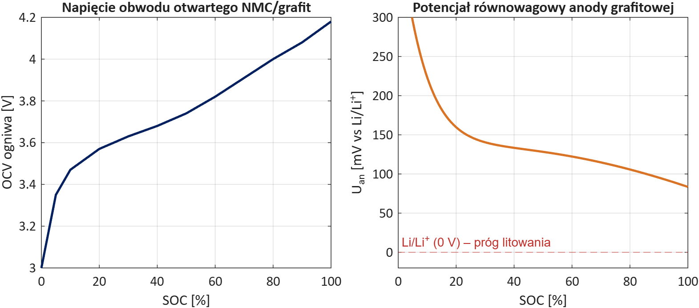
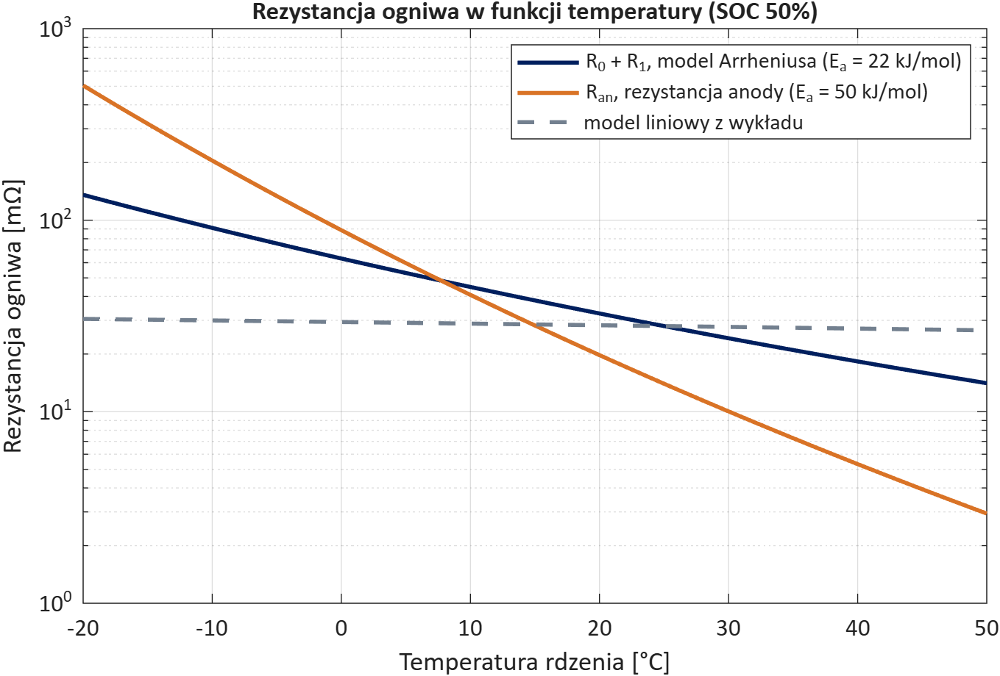
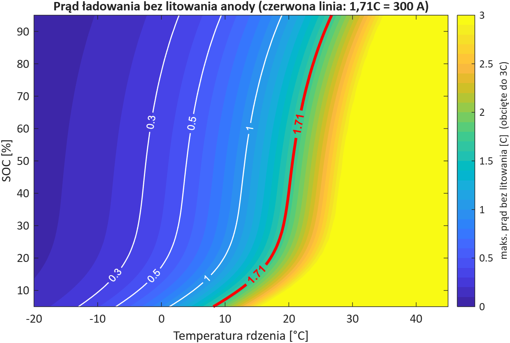
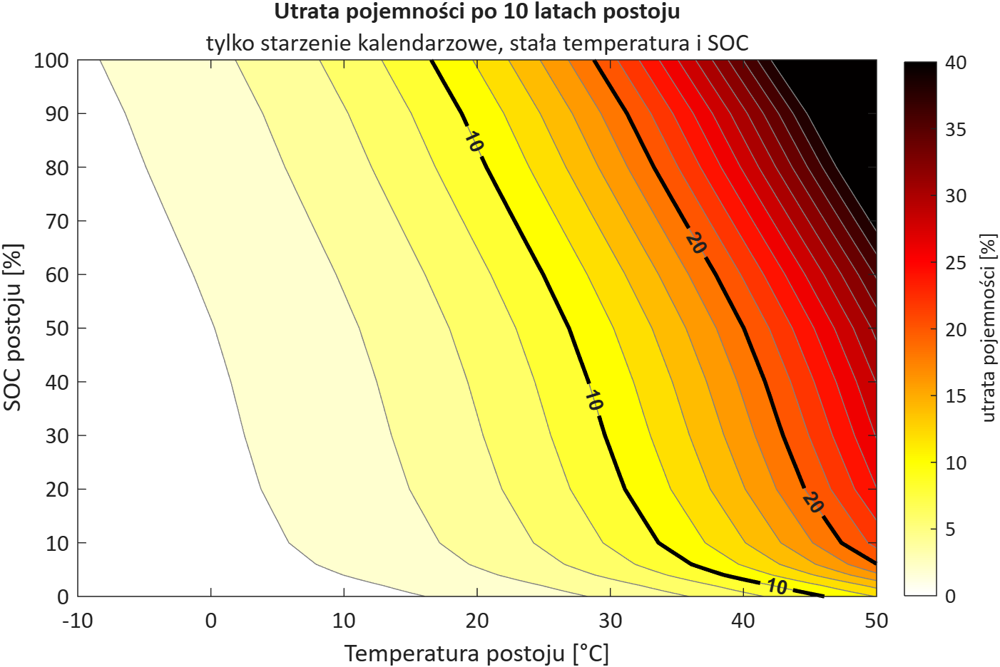
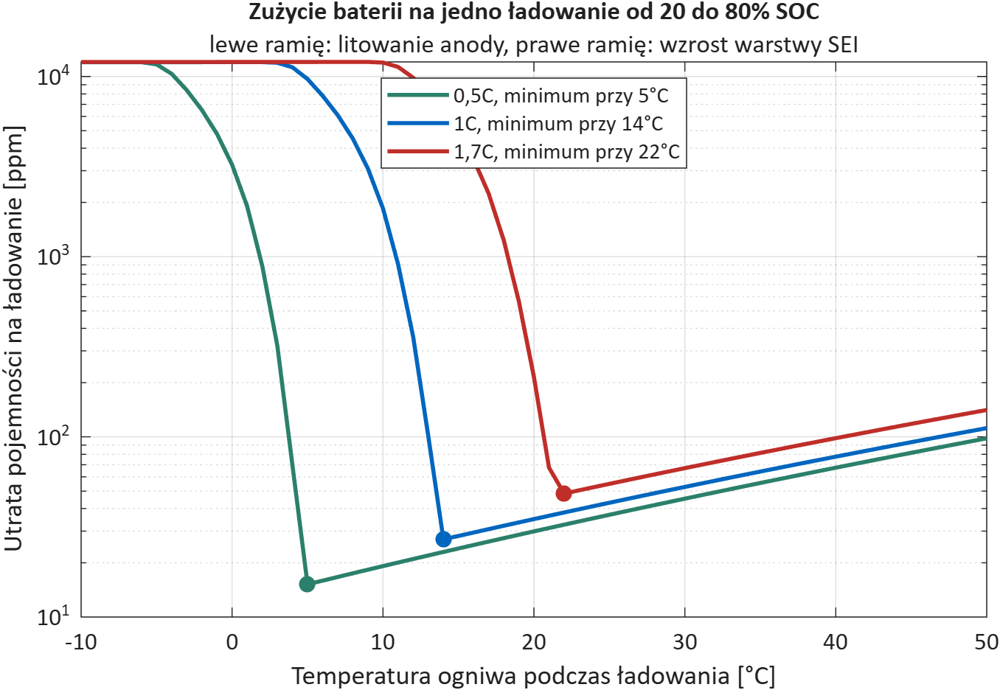

### E02. Szybkie ładowanie od 20 do 80%

| Strategia | 0°C: czas / T_c,max | 25°C | 35°C | litowanie przy 0°C |
|---|---|---|---|---|
| CC | 22,6 min / 30,7°C | 22,6 / 39,4 | 22,6 / 45,1 | 2582 ppm |
| PI | 22,6 / 32,1 | 22,6 / 35,4 | 22,6 / 36,6 | 2582 ppm |
| GS | 22,6 / 32,0 | 22,6 / 34,8 | 22,6 / 36,6 | 2582 ppm |
| GS-SAFE | 22,6 / 30,5 | 22,6 / 32,2 | 22,6 / 36,4 | 2582 ppm |
| STD-90 | **46,7** / 22,3 | 22,7 / 35,3 | 22,7 / 36,3 | 47 ppm |
| **LIFE** | **21,0** / 31,5 | 21,0 / 32,2 | 21,0 / 32,3 | **0** |

Przy 0°C LIFE zużywa 1,27 kWh na podgrzanie w trasie. W zamian ładuje się 2,2× szybciej niż typowy BMS i w ogóle nie lituje anody. Strategie bez limitu anody tracą przy 0°C około 2600 ppm pojemności na jedną sesję. To około 38× więcej niż LIFE.

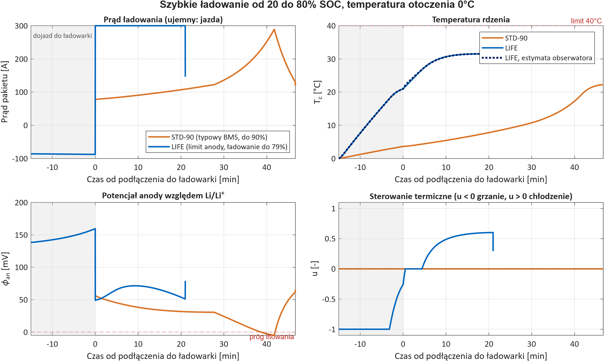
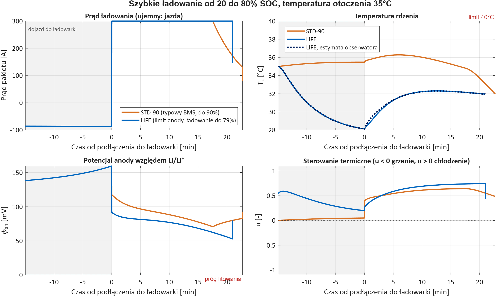
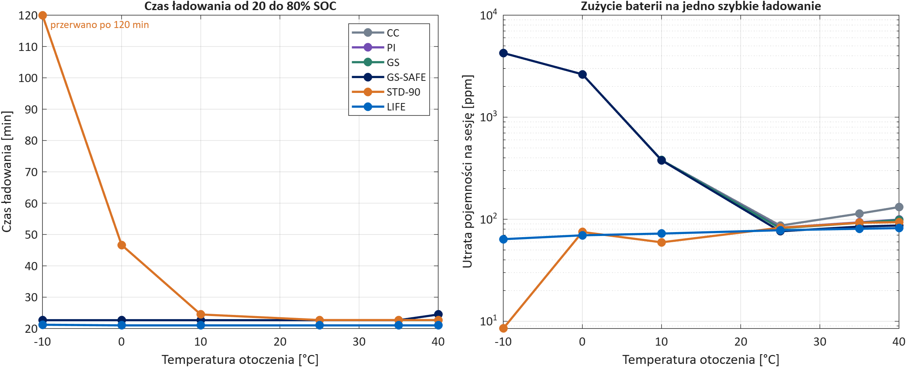

### E03. Gain scheduling

| ρ = T_s − T_chill | ω_c PI [mrad/s] | ω_c GS [mrad/s] | PM PI | PM GS |
|---|---|---|---|---|
| 6 K | 0,88 | 2,61 | 92,9° | 88,8° |
| 10 K | 1,51 | 2,61 | 91,3° | 88,8° |
| 17 K (punkt projektowy) | 2,61 | 2,61 | 88,8° | 88,8° |

Przy stałych nastawach pulsacja odcięcia maleje proporcjonalnie do ρ, czyli przy ρ = 6 K regulator PI jest 3× wolniejszy. GS utrzymuje ω_c stałe w zakresie ρ ≥ 5,7 K. Poniżej harmonogram nasyca się na k = 3. Porównanie nieliniowe (sesja od 25 do 80% jak na wykładzie): T_c,max PI/GS = 34,11/33,73°C (15°C), 35,29/34,71°C (25°C), 36,17/35,92°C (35°C).

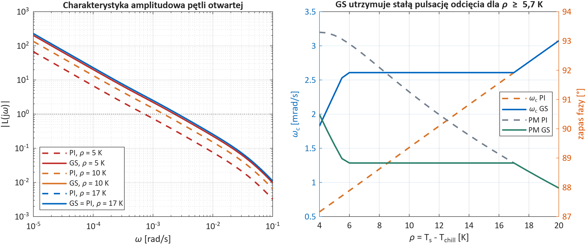
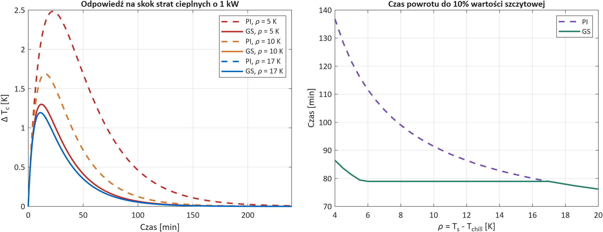

### E04. Temperatura szybkiego ładowania

Gdy bateria ma 5°C, strategia bez limitu anody traci 2247 ppm na sesję. LIFE traci 36 ppm za cenę +8,4 min ładowania. Powyżej około 33°C ładowanie hamuje nadzór termiczny. W oknie 17,5 do 30°C LIFE ładuje się najkrócej (21 min) i bez litowania.

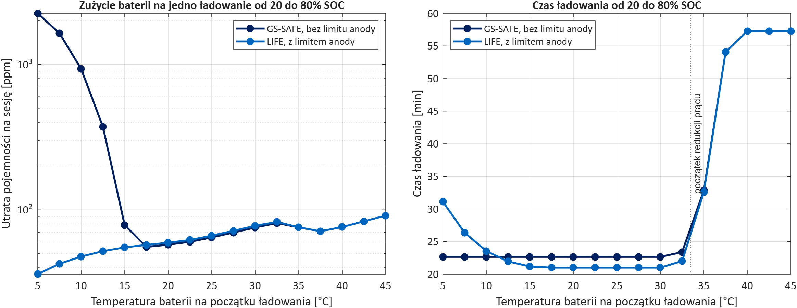

### E05. 10 lat eksploatacji (wynik główny)

| SOH po 10 latach | STD-100 | STD-90 | LIFE | LIFE-ADAPT |
|---|---:|---:|---:|---:|
| Opole | 81,1% | 85,0% | 87,9% | 87,6% |
| Madryt | **79,1%** ✗ | 82,3% | 85,2% | 84,6% |
| Dubaj | **69,2%** ✗ | **72,5%** ✗ | **78,3%** ✗ | **80,8%** ✓ |

| Koszt (Dubaj) | STD-100 | STD-90 | LIFE | LIFE-ADAPT |
|---|---:|---:|---:|---:|
| energia termiczna [kWh/rok] | 28 | 30 | 166 | 396 |
| średni SOC [%] (zapas zasięgu) | 96,5 | 86,7 | 68,3 | 59,9 |
| docelowy SOC ładowania AC [%] | 100 | 90 | 79 | 70 (średnio) |

Najważniejsze obserwacje:

- **W gorącym klimacie dominuje starzenie kalendarzowe:** w Dubaju STD-100 traci 19,8% kalendarzowo. LIFE-ADAPT ogranicza to do 11,0% przez niższy SOC postoju i chłodzenie z sieci, gdy auto stoi z wtyczką.
- **W zimnym klimacie problemem jest litowanie:** w Opolu STD-100 traci 3,8% przez litowanie przy zimowym ładowaniu AC do 100%. LIFE ma 0% litowania we wszystkich klimatach.
- **Pętla adaptacyjna rozdziela ochronę tam, gdzie jest potrzebna:** w Opolu i Madrycie λ spada do 0 (SOC do 85%, komfort). W Dubaju λ rośnie do nasycenia λ = 1 po około 4 latach. To typowy przykład nasycenia elementu wykonawczego: cel 82% nie jest osiągalny, ale 80% tak.
- **Uczciwy koszt:** 80% SOH w Dubaju kosztuje około 400 kWh/rok energii termicznej (około 10% energii jazdy) i średni SOC 60%.

Uwaga do T_c,max: w Dubaju pakiet nagrzewa się do około 41,5°C na parkingu bez wtyczki (otoczenie 42°C). To nie jest efekt ładowania, a BTMS nie działa w uśpieniu.

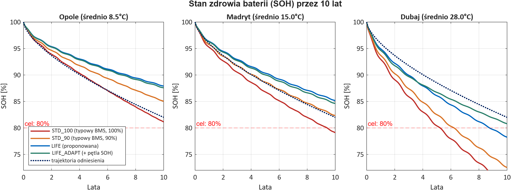
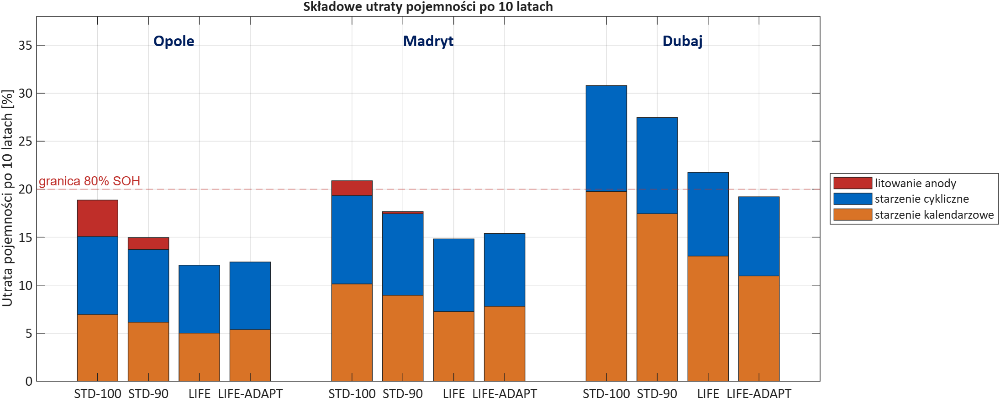
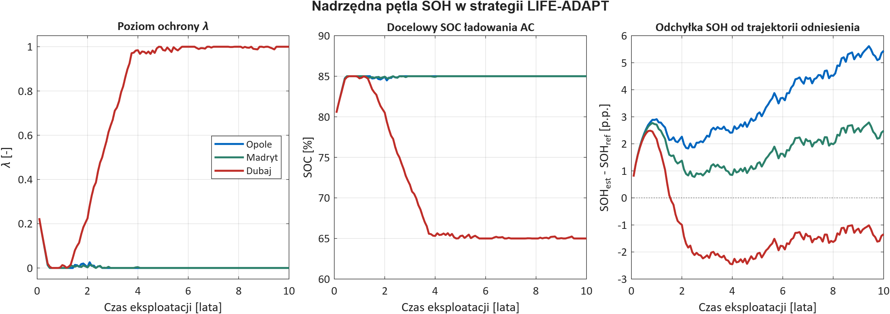
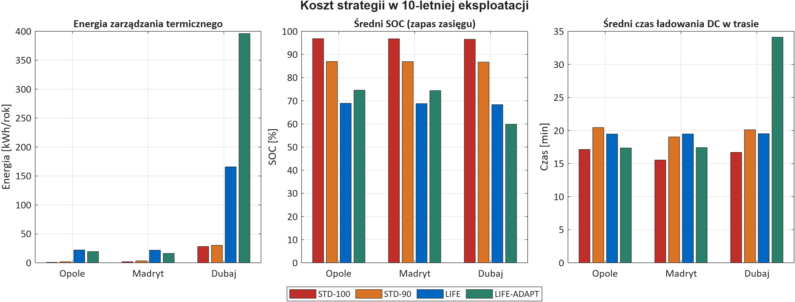

---

## 7. Odporność i walidacja

### E06. Monte Carlo (Madryt, 50 losowych pakietów)

Regulator zna tylko parametry nominalne. „Rzeczywisty” pakiet ma losowe:

- k_cal, k_cyc × lognormal(σ = 0,3),
- E_a,cal ± 5%,
- R ± 15%, G_cs, G_cool ± 20%,
- k_pl × 0,5…2,
- klimat ± 2 K,
- **strukturę** degradacji cyklicznej: √FEC albo liniową (z p. 50%, motywacja: E08).

| Strategia | średnie SOH | odch. std. | min | spełnia cel 80% |
|---|---:|---:|---:|---:|
| STD-90 | 81,4% | 4,09 p.p. | 69,0% | 72% |
| LIFE | 85,3% | 3,32 p.p. | 76,7% | 92% |
| LIFE-ADAPT | 84,9% | 2,98 p.p. | 78,5% | 96% |

Strategie w pętli otwartej dziedziczą całą niepewność modelu starzenia. LIFE-ADAPT mierzy SOH i koryguje parametry ładowania, więc zawęża rozkład. To jest istota sterowania odpornego przez sprzężenie zwrotne.

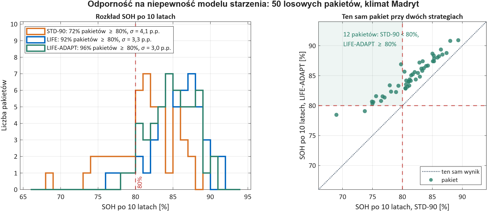

### E07. Identyfikacja online RLS

Model ARX y[k] = a·y[k−1] + b₀I[k] + b₁I[k−1] (y = U − OCV) jest dokładny dla ECM 1RC. Parametry: R₀ = b₀, τ = −Δt/ln a, R₁ = (b₁ + a·b₀)/(1 − a). W 30. minucie rezystancje rosną skokowo o 30%.

| parametr | prawda (przed) | RLS 0,995 (przed) | prawda (po) | RLS 0,995 (po) | RLS 1,0 (po) |
|---|---:|---:|---:|---:|---:|
| R0 [mOhm] | 17,41 | 17,22 | 23,29 | 23,17 | 19,95 |
| R1 [mOhm] | 9,67 | 7,77 | 12,94 | 12,12 | 11,00 |
| tau [s] | 40,00 | 25,27 | 40,00 | 33,92 | 39,79 |

Estymator bez zapominania (λ = 1) nie nadąża za zmianą, bo „pamięta” całą historię. Zapominanie jest warunkiem adaptacji. Estymaty R₁ i τ są obciążone, ponieważ szum pomiaru trafia do regresora y[k−1] (błąd typu errors-in-variables w ARX).

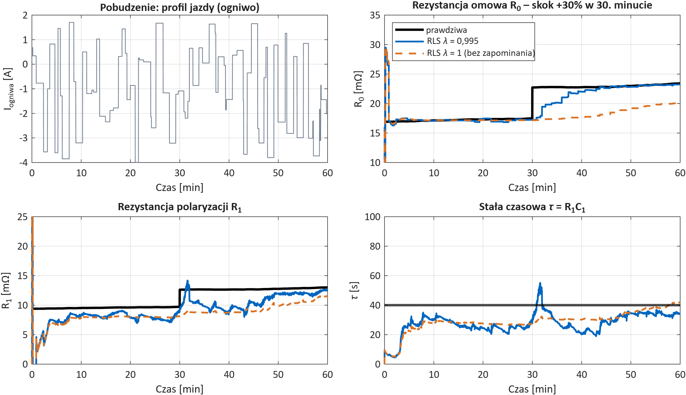

### E08. Dane NASA B0005

Dane: ogniwo 18650 (2 Ah), cykle w 24°C, 168 rozładowań. Model Q(n) = Q₀ − b·nᶻ dopasowany na 70% cykli i sprawdzony na pozostałych 30%:

| model | RMSE uczenie [mAh] | RMSE test [mAh] |
|---|---:|---:|
| dopasowane z = 1.54 | 21,6 | 138,0 |
| z = 0.5 (pierwiastek) | 53,9 | 80,7 |
| z = 1 (liniowy) | 31,3 | 31,6 |

Najlepiej na danych testowych wypada model liniowy (z = 1). Dopasowany wykładnik z = 1,54 dobrze opisuje dane uczące, ale gorzej prognozuje. Ogniwo NASA, cyklowane głęboko (do 2,7 V) prądem 2 A, starzeje się raczej liniowo niż pierwiastkowo. Dlatego w analizie Monte Carlo (E06) dopuszczamy oba kształty degradacji cyklicznej. Pętla adaptacyjna nie zakłada kształtu krzywej: reaguje na zmierzone SOH.

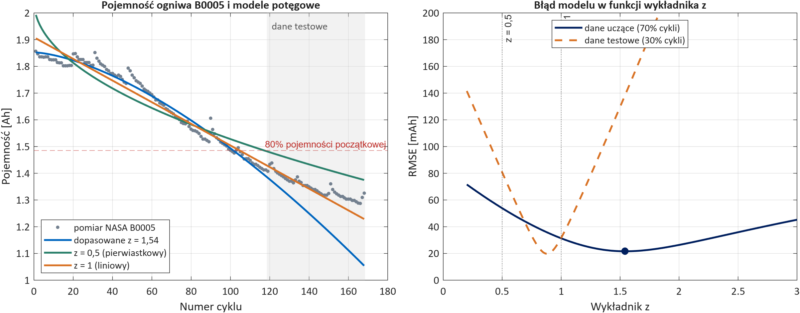

### E09. Simulink i MATLAB

Model `simulink/btms_life_simulink.slx` buduje skrypt `build_btms_simulink.m`. Harmonogram GS to standardowy blok *1-D Lookup Table*. Bloki MATLAB Function wywołują te same funkcje co skrypty. Sesja LIFE przy 0°C: Simulink 1544 kroków, MATLAB 1544 kroków; max |ΔTc| = 5.0e-07 K, |ΔTs| = 7.5e-07 K, |ΔSOC| = 0.0e+00, |ΔI| = 0.0e+00 A, |Δu| = 7.4e-07. Czas ładowania: 25,7 min w obu narzędziach. Różnice wynikają tylko z interpolacji tablicy GS i są pomijalne.

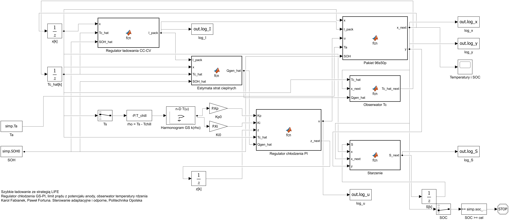
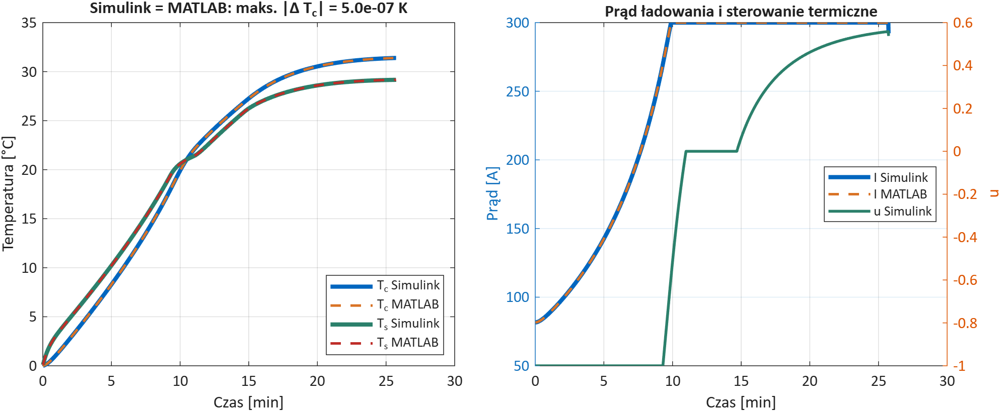

### Testy poprawności (`run_tests`)

| test | wynik | wartość |
|---|---|---|
| T1 bilans energii, reszta w kroku poniżej 1e-6 J | OK | 1.68e-09 J |
| T2 bilans ładunku, całka prądu równa zmianie SOC | OK | 9.88e-15 |
| T3 zbieżność względem kroku, różnica Tc,max poniżej 0,05 K | OK | 0.000 K |
| T4 stabilność przy kroku 600 s, monotoniczne stygnięcie | OK | T_end = 10.000 °C |
| T5 faza CV, napięcie ogniwa nie przekracza 4,202 V | OK | U_max = 4.2000 V |
| T6 strategia LIFE, potencjał anody nieujemny od -10 do 25°C | OK | phi_min = 11.0 mV |
| T7 harmonogram GS, k(17 K) = 1 i k(2 K) = 3 | OK |  |
| T8 obserwator, błąd estymacji Tc poniżej 0,1 K po 10 min | OK | 0.0841 K |
| T9 starzenie rośnie z temperaturą, SOC i prądem | OK | 35°C: 2.05, SOC 90%: 1.84, 2C: 1.42 raza |
| T10 kalibracja, starzenie kalendarzowe 9% po 10 latach w 25°C | OK | 0.0900 |
| T11 powtarzalność, to samo ziarno daje ten sam wynik | OK | SOH(1 rok) = 0.96243 |
| T12 pakiet 96s50p, 175 Ah, 60,48 kWh, 53,76 mOhm | OK |  |

---

## 8. Ograniczenia

- Współczynniki starzenia pochodzą z literatury, a nie z badań tego ogniwa. Wartości bezwzględne SOH wymagają kalibracji. Porównanie strategii jest wiarygodniejsze niż pojedyncze liczby.
- Pakiet modelujemy jako jedno „średnie” ogniwo, bez rozrzutu parametrów i gradientów temperatury między modułami.
- Litowanie opisuje model progowy (potencjał anody z ECM), a nie elektrochemiczny model P2D.
- Klimat to sinusoida: bez pogody, nasłonecznienia i parkowania w garażu. Jeden reprezentatywny dzień przypada na miesiąc.
- Pomiar SOH w pętli adaptacyjnej modelujemy jako wartość prawdziwą + szum. W BMS wymaga to estymatora pojemności (np. liczenia ładunku między punktami OCV).

---

## 9. Struktura kodu

```
Projekt/
├── start_here.m              menu
├── run_all.m                 testy + E01–E09 + results/PODSUMOWANIE.md
├── bms_setup.m               ścieżki
├── config/   bms_params.m, bms_derive.m      parametry ([W]/[L]/[Z])
├── model/    pack_step.m                     ECM 1RC + termika (niejawny Euler)
│             ocv_nmc.m, anode_ocp.m, cell_resistance.m
│             aging_stress.m, aging_update.m, aging_init.m
├── control/  gs_gains.m, thermal_controller.m, core_observer.m
│             charge_controller.m             warstwowy limit prądu
│             strategy_config.m, apply_lambda.m
│             soh_supervisor.m, soh_reference.m   RLS + PI budżetu zdrowia
├── sim/      bms_step.m                      krok układu zamkniętego
│             simulate_session.m, simulate_day.m, simulate_lifetime.m
│             climate_profile.m, ambient_temp.m, init_state.m
├── experiments/ exp01 … exp08, perturb_params.m
├── lab/      lab1 do lab5, ćwiczenia laboratoryjne (opis: LABORATORIUM.md)
├── simulink/ build_btms_simulink.m, run_simulink_validation.m, btms_life_simulink.slx
├── tests/    run_tests.m
├── utils/    lin_interp.m, plot_style.m, save_fig.m, save_csv.m
├── data/     B0005.mat (NASA)
├── results/  *.csv, e05_lifetime.mat, PODSUMOWANIE.md
└── figures/  *.png
```

---

## 10. Bibliografia

1. Schmalstieg J., Käbitz S., Ecker M., Sauer D. U., *A holistic aging model for Li(NiMnCo)O2 based 18650 lithium-ion batteries*, J. Power Sources 257 (2014) 325–334.
2. Waldmann T., Wilka M., Kasper M., Fleischhammer M., Wohlfahrt-Mehrens M., *Temperature dependent ageing mechanisms in Lithium-ion batteries – A Post-Mortem study*, J. Power Sources 262 (2014) 129–135.
3. Wang J. i in., *Cycle-life model for graphite-LiFePO4 cells*, J. Power Sources 196 (2011) 3942–3948.
4. Doyle M., Newman J., Gozdz A. S., Schmutz C. N., Tarascon J.-M., *Comparison of modeling predictions with experimental data from plastic lithium ion cells*, J. Electrochem. Soc. 143 (1996) 1890–1903.
5. Plett G. L., *Battery Management Systems*, tomy I–II, Artech House, 2015–2016.
6. Rugh W. J., Shamma J. S., *Research on gain scheduling*, Automatica 36(10) (2000) 1401–1425.
7. Åström K. J., Wittenmark B., *Adaptive Control*, 2nd ed., Addison-Wesley, 1995.
8. Saha B., Goebel K., *Battery Data Set*, NASA Ames Prognostics Data Repository, 2007.
9. Lin X. i in., *Online parameterization of lumped thermal dynamics in cylindrical lithium ion batteries*, IEEE Trans. Control Syst. Technol. 21(5) (2013).
10. Bhundiya H., Hunt M., Drolen B., *Effective radial thermal conductivities of 18650 and 26650 Li-ion cells*, TFAWS 2018.
