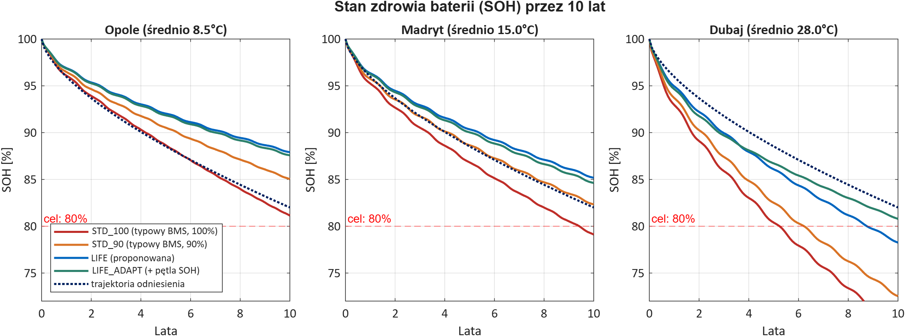
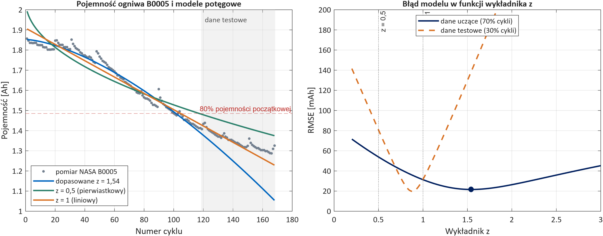

# Trwałość baterii EV: sterowanie ładowaniem i temperaturą dla SOH ≥ 80% po 10 latach

Projekt z przedmiotu **Sterowanie adaptacyjne i odporne** (Politechnika Opolska, WEAiI).
Autorzy: **Karol Fabianek, Paweł Fortuna**.

Projekt modeluje i steruje pakietem Li-ion 96s50p (60,5 kWh) samochodu elektrycznego. Strategia ma utrzymać **co najmniej 80% pojemności po 10 latach**. Steruje w tym celu parametrami ładowania (prąd, napięcie, okno SOC, moment ładowania) i temperaturą pakietu. Projekt rozwija wykład [*Zarządzanie termiczne baterią EV z zastosowaniem Gain Scheduling*](Prezentacja/BTMS_WYKLAD_FABIANEK_FORTUNA.pdf).

| Dokument | Zawartość |
|---|---|
| [LABORATORIUM.md](LABORATORIUM.md) | 5 ćwiczeń laboratoryjnych (`Projekt/lab/`) z zadaniami i oczekiwanymi wynikami |
| [Projekt/docs/DOKUMENTACJA.md](Projekt/docs/DOKUMENTACJA.md) | równania, regulatory, metodyka, wszystkie wyniki |
| [Prezentacja projektu (PDF)](Prezentacja/BTMS_PROJEKT_FABIANEK_FORTUNA.pdf) · [PPTX](Prezentacja/BTMS_PROJEKT_FABIANEK_FORTUNA.pptx) | slajdy z wynikami |
| [Wykład (PDF)](Prezentacja/BTMS_WYKLAD_FABIANEK_FORTUNA.pdf) · [PPTX](Prezentacja/BTMS_WYKLAD_FABIANEK_FORTUNA.pptx) | gain scheduling w BTMS – zaktualizowany do wyników projektu |
| [Skrypt wystąpień](Prezentacja/SKRYPT_PREZENTACJI.md) | tekst do każdego slajdu obu prezentacji z podziałem na osoby (Karol Fabianek / Paweł Fortuna) |



## Główne wyniki

**SOH po 10 latach** (15 tys. km dojazdów + 24 trasy po 300 km z szybkim ładowaniem rocznie):

| Klimat | STD_100 – typowy BMS, ładowanie do 100% | STD_90 | **LIFE** – proponowana | **LIFE_ADAPT** – z pętlą SOH |
|---|---:|---:|---:|---:|
| Opole (śr. 8,5°C) | 81,1% | 85,0% | 87,9% | 87,6% |
| Madryt (śr. 15°C) | 79,1% ✗ | 82,3% | 85,2% | 84,6% |
| Dubaj (śr. 28°C) | 69,2% ✗ | 72,5% ✗ | 78,3% ✗ | **80,8% ✓** |

- **Szybkie ładowanie przy 0°C:** typowy BMS potrzebuje 46,7 min (20 → 80%). LIFE podgrzewa pakiet w drodze do ładowarki (1,27 kWh) i ładuje w **21 min bez litowania anody**. Ładowanie bez ochrony anody zużywa baterię ok. 38× bardziej.
- **Gain scheduling:** pulsacja odcięcia pętli termicznej jest stała w całym zakresie pracy. Przy stałych nastawach PI spada 3× przy ρ = 6 K.
- **Odporność (Monte Carlo, 50 pakietów z niepewnym modelem starzenia):** cel 80% spełnia 72% pakietów ze strategią STD_90, 92% z LIFE i **96% z LIFE_ADAPT**.
- **Simulink = MATLAB:** model blokowy i skrypt dają te same przebiegi (max |ΔTc| = 5e-07 K).
- **12/12 testów poprawności** (bilans energii i ładunku, zbieżność, CV, obserwator, kalibracja).

## Co jest w projekcie

- **Model pakietu:** ECM 1RC + OCV(SOC), R(T) wg Arrheniusa, faza CC-CV, dwuwęzłowy model cieplny (rdzeń–powierzchnia), chiller i grzałka. Całkowanie niejawne: 10 lat eksploatacji liczy się w ok. 9 s (laptop na zasilaczu).
- **Potencjał anody i litowanie (Li plating):** model decyduje, jaki prąd jest bezpieczny w danej temperaturze, przy danym SOC i SOH.
- **Starzenie:** kalendarzowe (t^0,75, Arrhenius, napięcie), cykliczne (√FEC, C-rate, SOC), litowanie; sprzężenie SOH → pojemność i rezystancja.
- **Sterowanie w trzech skalach czasu:**
  - 1 s: GS-PI chłodzenia z feedforwardem i anti-windupem, warstwowy limit prądu, obserwator temperatury rdzenia;
  - sesja/doba: ładowanie AC „just in time”, podgrzewanie przed DC, ochrona termiczna na postoju;
  - miesiąc: estymator RLS stanu zdrowia + regulator PI „budżetu zdrowia”, który adaptuje parametry ładowania.
- **9 eksperymentów** (E01–E09): mapy modelu, sesje ładowania, analiza częstotliwościowa GS, optymalna temperatura ładowania, 10 lat × 3 klimaty, Monte Carlo, identyfikacja RLS, dane NASA B0005, model Simulink.

## Ciekawostki z projektu

| | |
|---|---|
|  | **Anoda pracuje ok. 100 mV nad metalicznym litem.** Przy SOC 80% bezpieczny prąd ładowania to 1,85C w 25°C, ale tylko 0,29C w 0°C. Zimą nawet wolne ładowanie AC do 100% może litować anodę – w Opolu typowy BMS traci przez to 3,8 p.p. pojemności w 10 lat. |
|  | **Istnieje optymalna temperatura szybkiego ładowania** (kształt „V”, Waldmann i in. 2014): lewe ramię to litowanie, prawe – wzrost SEI. Optimum rośnie z prądem: 5°C dla 0,5C, 14°C dla 1C, 22°C dla 1,71C. |
|  | **Bateria starzeje się także na postoju.** 100% SOC przyspiesza starzenie ok. 2,2× względem 50%, a +10 K – ok. 2×. W Dubaju sam postój przy 100% zabiera 19,8% pojemności w 10 lat. |
|  | **Sprzężenie zwrotne od SOH kompensuje błędy modelu starzenia.** Na 50 losowych pakietach cel 80% spełnia 72% z typowym BMS i 96% z pętlą adaptacyjną; odchylenie standardowe maleje z 4,1 do 3,0 p.p. |
|  | **Prawdziwe ogniwo nie musi trzymać się założonego modelu.** Dane NASA B0005 lepiej opisuje degradacja liniowa niż pierwiastkowa, a najlepiej dopasowany wykładnik prognozuje najgorzej (przeuczenie). |

Projekt działa w MATLAB R2026b bez dodatkowych toolboxów; model blokowy wymaga Simulinka. Wszystkie wyniki i wykresy w repozytorium zostały wygenerowane w tej wersji.

## Struktura repozytorium

```
├── README.md
├── LABORATORIUM.md
├── Prezentacja/              prezentacja projektu, wykład (.pptx + .pdf), skrypt wystąpień
└── Projekt/
    ├── start_here.m, run_all.m, bms_setup.m
    ├── config/               parametry (bms_params.m – jedno miejsce na wszystkie liczby)
    ├── model/                pakiet, anoda, rezystancja, starzenie
    ├── control/              GS-PI, obserwator, limit prądu, strategie, pętla SOH
    ├── sim/                  sesja, doba, 10 lat, klimat
    ├── experiments/          E01–E08
    ├── lab/                  ćwiczenia laboratoryjne lab1–lab5
    ├── simulink/             budowa i walidacja modelu .slx (E09)
    ├── tests/                testy poprawności
    ├── data/                 NASA B0005
    ├── results/              wyniki CSV + PODSUMOWANIE.md
    ├── figures/              wykresy PNG
    └── docs/                 DOKUMENTACJA.md
```

## Ograniczenia

Współczynniki starzenia pochodzą z literatury, a nie z badań konkretnego ogniwa. Dlatego wyniki służą przede wszystkim do porównania strategii. Wpływ tej niepewności badamy metodą Monte Carlo (E06). Pełna lista ograniczeń jest w [dokumentacji, rozdział 8](Projekt/docs/DOKUMENTACJA.md#8-ograniczenia).

Poprzednia wersja projektu (model z wykładu) jest zachowana w tagu [`v1-wyklad`](https://github.com/KarolFabianek/Adaptive-and-robust-control/tree/v1-wyklad).
