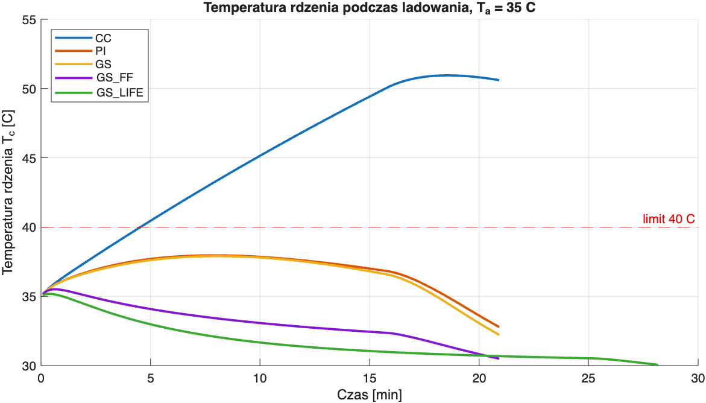

# Sterowanie chłodzeniem baterii EV podczas szybkiego ładowania (BTMS)

Model cieplny pakietu Li-ion samochodu elektrycznego i porównanie ośmiu strategii sterowania chłodzeniem cieczowym. Strategie idą od stałego chłodzenia, przez regulator PI, po gain scheduling z feedforwardem i nadzorem prądu. Dla każdej sprawdzamy temperaturę ogniw podczas szybkiego ładowania od 25 do 80% SOC oraz prognozę stanu zdrowia baterii (SOH) po 10 latach.

**Autorzy:** Karol Fabianek, Paweł Fortuna
Politechnika Opolska, Wydział Elektrotechniki, Automatyki i Informatyki

| Dokument | |
|---|---|
| [Pełna dokumentacja (PDF, 25 stron)](Projekt/docs/DOKUMENTACJA_BTMS.pdf) | model, regulatory, starzenie, weryfikacja, wyniki, literatura |
| [Raport techniczny (PDF, 2 strony)](Projekt/docs/RAPORT_TECHNICZNY.pdf) | skrót najważniejszych wyników |
| [Prezentacja (PDF)](Prezentacja/BTMS_WYKLAD_FABIANEK_FORTUNA.pdf) | slajdy z wykładu (jest też wersja .pptx) |



## Cel

- temperatura rdzenia ogniw **poniżej 40°C** w każdej sesji ładowania,
- **SOH ≥ 80%** po 10 latach eksploatacji.

## Wyniki przy temperaturze otoczenia 35°C

| Strategia | Tmax rdzenia | Czas ładowania | Energia chłodzenia | SOH po 10 latach* |
|---|---:|---:|---:|---:|
| CC – stałe chłodzenie, bez regulatora | 50,95°C | 20,9 min | 0,175 kWh | 70,4% |
| PI | 37,96°C | 20,9 min | 0,667 kWh | 74,1% |
| GS – gain scheduling | 37,90°C | 20,9 min | 0,685 kWh | 74,2% |
| GS_SAFE – GS + feedforward + nadzór prądu | 35,51°C | 20,9 min | 0,781 kWh | 75,6% |
| GS_LIFE – GS_SAFE + limit 210 A | 35,18°C | 28,2 min | 0,570 kWh | 77,1% |

\* postój przy 50% SOC, średnia roczna temperatura 35°C

- Bez regulatora rdzeń dochodzi do 51°C. Regulator PI trzyma ok. 38°C kosztem ok. 2% energii ładowania, a z feedforwardem ok. 35,5°C.
- W 162 symulacjach z niepewnymi parametrami (rezystancja ±15%, przewodności ±20%, otoczenie 32–38°C) maksimum wynosi 38,17°C.
- Cel 80% SOH jest spełniony, gdy średnia temperatura postoju nie przekracza 27°C. Przy średniej 35°C sam regulator ładowania nie wystarcza: trzeba chłodzić pakiet także na postoju albo obniżyć SOC postoju. Wariant W3 z [`goal80_study/`](Projekt/goal80_study/README.md) daje 80,7% przy ok. 3% dodatkowej energii.

## Model w skrócie

- **Model cieplny:** pakiet 96s50p (4800 ogniw 18650, 60,5 kWh) opisany dwoma węzłami, rdzeniem i powierzchnią. Równania całkowane są metodą Eulera z krokiem 5 s.
- **Sterowanie:**
  - regulator PI temperatury rdzenia (Tref = 30°C) z anti-windupem,
  - gain scheduling po ρ = Ts − Tcool,
  - feedforward od ciepła I²R,
  - nadzór prądu powyżej 36,5°C.
- **Starzenie:** kalendarzowe (∝ √t) i cykliczne (∝ liczba cykli). Oba rosną wykładniczo z temperaturą, a kalendarzowe dodatkowo z SOC postoju.
- **Weryfikacja:**
  - testy poprawności (bilans energii, zbieżność kroku),
  - test odporności,
  - lokalna analiza stabilności (54 punkty pracy),
  - wrażliwość na przewodność Gcs,
  - dane NASA B0005,
  - model Simulink zgodny z MATLAB-em z błędem 0.

## Struktura repozytorium

```
Prezentacja/              slajdy (.pptx i .pdf)
Projekt/
├── main.m                główny skrypt: 24 symulacje, SOH po 10 latach, wykresy
├── params.m              wszystkie parametry modelu, regulatora i starzenia
├── model_step.m          jeden krok symulacji
├── simulate_charging.m   jedna sesja ładowania
├── controller_gains.m    nastawy PI i gain scheduling
├── aging_model.m         model starzenia
├── robustness_test.m     test odporności (162 symulacje)
├── stability_analysis.m  linearyzacja i wartości własne
├── gcs_sensitivity.m     wrażliwość na Gcs
├── goal80_analysis.m     warunki spełnienia celu 80% SOH
├── nasa_validation.m     dane NASA B0005
├── check_results.m       testy poprawności
├── btms_model.slx        model Simulink (R2025b) + btms_sfun.m, run_simulink.m
├── data/                 B0005.mat
├── results/              wyniki (CSV)
├── figures/              wykresy (PNG)
├── goal80_study/         studium: jak osiągnąć 80% SOH przy 35°C
└── docs/                 dokumentacja PDF
```

Opis każdego pliku jest w [`Projekt/README.md`](Projekt/README.md).

## Uruchomienie

Wymagany MATLAB R2025b. Simulink jest potrzebny tylko do `run_simulink.m`.

```matlab
cd Projekt
main            % 24 symulacje, SOH, wykresy -> results/, figures/
check_results   % testy poprawności: [OK] / [BLAD]
```

Pozostałe skrypty (`robustness_test`, `stability_analysis`, `gcs_sensitivity`, `goal80_analysis`, `nasa_validation`, `run_simulink`, `goal80_study/goal80_study`) są niezależne i można je uruchamiać w dowolnej kolejności.

## Ograniczenia

Model nie jest zwalidowany na pomiarach rzeczywistego pakietu, a część parametrów (m.in. współczynniki starzenia) jest przyjęta. Wyniki służą do porównania strategii, a nie do prognozy dla konkretnego pojazdu. Szczegóły są w rozdziale 7 [dokumentacji](Projekt/docs/DOKUMENTACJA_BTMS.pdf).
